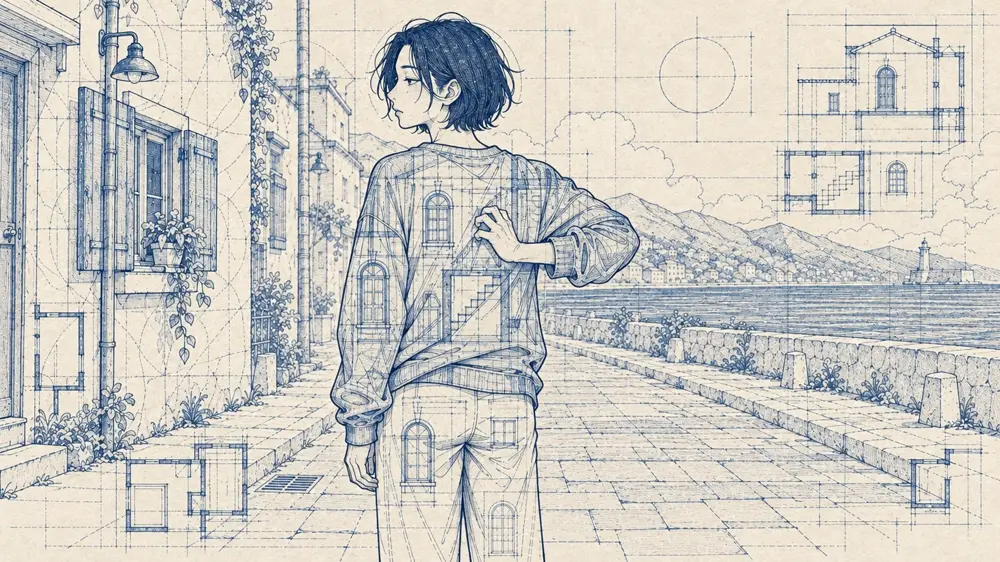
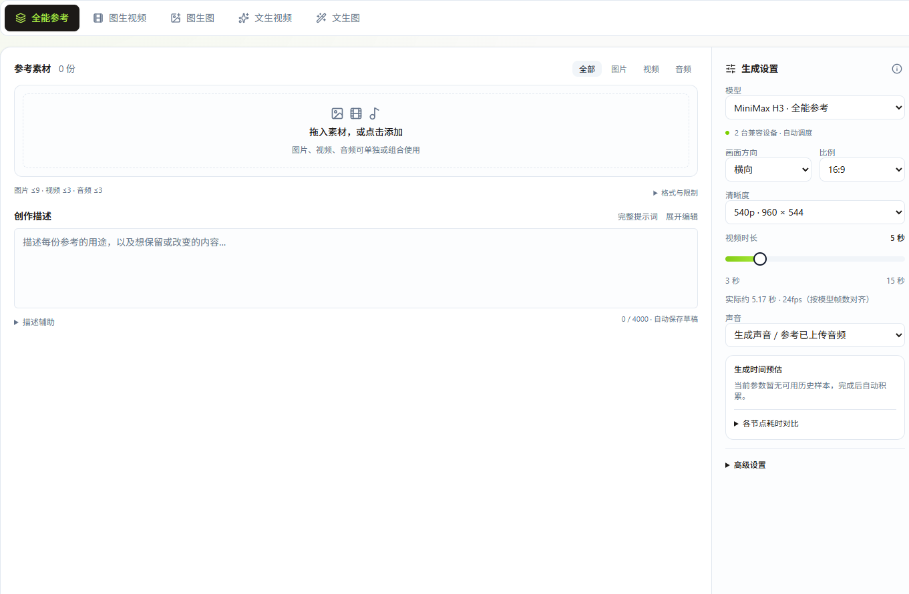

# xiazsa Lab

个人作品集，展示映序 FrameWeave、ClaudeBrainDuel 和 PPTX-TO-SPEECH。采用黑白海报设计，纸白、墨黑与信号红组成共享样式。

## 页面

- `index.html`：项目目录、工程实践与 GitHub 入口。
- `frameweave.html`：真实界面截图、重设计演示、短片播放与嵌入式交互画布。
- `workflow.html`、`workflow.css`、`workflow.js`：可缩放、拖动、搜索和浏览上下游的只读工作流。
- `style.css`、`showcase.js`：共享样式及界面演示切换。
- `assets/workflow/`：经作者指定公开的《寄居蟹》工作流素材、网页播放副本与精简节点数据。
- `assets/screens/`：裁去账号和旧品牌栏的真实运行截图。

## 展开真实制作过程

[打开交互画布](https://xiazsa.github.io/xiazsa-lab/workflow.html) · [阅读完整案例](https://xiazsa.github.io/xiazsa-lab/frameweave.html)



241 个节点、652 条连线，保留原画布布局与连接关系。点击创作阶段定位，点开节点浏览图片、播放视频或音频，并追溯上下游。支持全屏、节点搜索及键盘缩放和平移。



真实截图与重设计演示分别标注。工作流公开数据只保留展示所需的标题、类型、坐标、连线与本站媒体路径；不包含账号、原始内部标识、服务地址、凭据、生成提示词或运行配置。四个外部画风参考节点保留结构，不再分发原始参考图片。

公开展示不代表放弃作品权利。短片、图像和声音素材的使用需取得作者许可；上游软件许可见对应项目仓库。

无需安装前端依赖。可用任意静态服务器托管；本机预览：

```sh
python -m http.server 8765 --bind 127.0.0.1
```

生产部署上传三个 HTML、两个 CSS、两个 JS、`assets/`、`robots.txt` 和 `sitemap.xml`。历史设计稿、原始画布导出包和内部审阅记录不属于正式站点产物。此仓库不包含服务器地址、SSH 密钥或生产环境配置。

网页以静态文件提供工作流浏览与媒体播放，不连接 AIGC 生产环境或消耗生成额度。视频与音频按需加载。Fork 仓库的上游归属保持明确。

临时展示地址：[GitHub Pages](https://xiazsa.github.io/xiazsa-lab/)。正式域名 `xiazongchi.fun` 的阿里云部署已完成，备案已提交、审核中；最新外网检查 HTTP 被备案拦截，HTTPS 连接重置。审核通过后再验收正式域名和证书续期。
